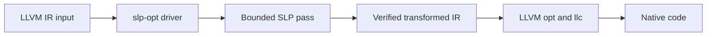
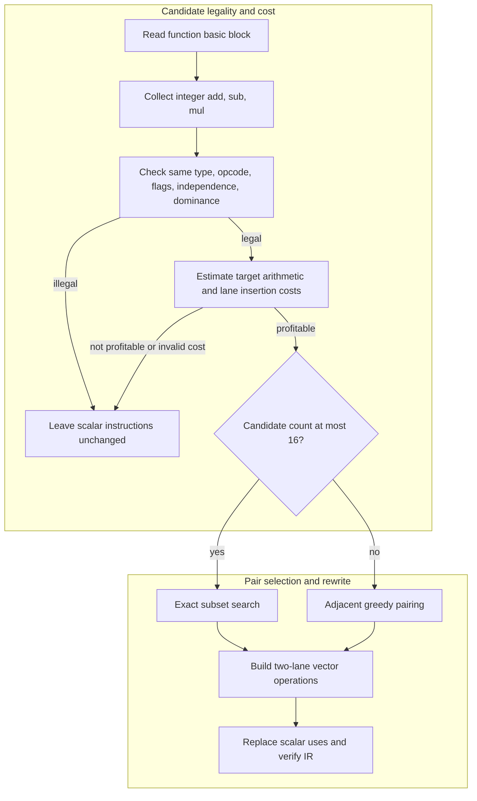

# Bounded LLVM SLP Vectorizer

This project adds a small, real LLVM function pass for packing independent scalar integer operations into two-lane SIMD operations. It is built on the complete MIT-licensed history of [`llvm-tutor`](https://github.com/banach-space/llvm-tutor), which remains in this repository as the tutorial collection. The exact inherited README is preserved in [`README.upstream.md`](README.upstream.md), and inherited CI workflows are retained byte-for-byte under [`docs/upstream/workflows`](docs/upstream/workflows/).

## Contents

- [Architecture and execution guide](#architecture-and-execution-guide)
- [What it does](#what-it-does)
- [Build and run on Windows](#build-and-run-on-windows)
- [Provenance and design mapping](#provenance-and-design-mapping)
- [Verification evidence](#verification-evidence)
- [Verification skill](.agents/skills/verify-bounded-slp/SKILL.md)

## Architecture and execution guide

The project adds a bounded [SLP vectorization](#slp) function pass and standalone driver to the inherited `llvm-tutor` examples. LLVM supplies IR, analyses, target costs, pass infrastructure, and code generation; the new pass selects and rewrites eligible integer operations in a basic block. It is a bounded pair-packing pass, not LLVM's full SLP vectorizer.



The driver parses and verifies the module, invokes the pass, verifies its output, and writes IR. LLVM tools then verify and lower the transformed module; plugin registration exists for shared LLVM hosts, while the documented Windows path uses the standalone driver.



[Dominance](#dominance) and other legality checks precede profitability. Exact search is bounded to 16 candidates per block; larger blocks use the greedy fallback. Unsupported or unprofitable operations remain scalar, and the cost estimate omits some construction and extraction costs.

| Subsystem | Responsibility and invariant | Source |
| --- | --- | --- |
| Input driver | Parses a module, verifies before and after pass execution, and writes output or returns an error. | [`BoundedSLPDriver.cpp`](tools/BoundedSLPDriver.cpp) |
| Candidate legality | Requires same operation/type/flags, independence, and operand dominance. | [`BoundedSLP.cpp`](lib/BoundedSLP.cpp) |
| Cost and pairing | Uses target arithmetic and insertion costs; runs exact search through 16 ops and greedy beyond. | [`BoundedSLP.cpp`](lib/BoundedSLP.cpp) |
| Vector rewrite | Creates vector operations, extracts scalar lanes, and replaces original uses. | [`BoundedSLP.cpp`](lib/BoundedSLP.cpp) |
| LLVM integration | Registers pass names for LLVM's new pass manager. | [`BoundedSLP.cpp`](lib/BoundedSLP.cpp), [`BoundedSLP.h`](include/BoundedSLP.h) |

The compilation journey is:

1. Pass LLVM IR to `slp-opt.exe`. The driver rejects unreadable input and invalid IR before running any transformation.
2. The pass groups eligible independent integer arithmetic in each basic block. It checks operation flags and dominance before considering target cost.
3. For up to 16 candidates, exact mode maximizes estimated savings and uses insertion cost as a tie-breaker. Larger groups use adjacent greedy pairing; `--greedy` selects that baseline directly.
4. Profitable pairs become two-lane vector operations, and scalar results are replaced by extracted lanes. Unmatched operations stay scalar.
5. The driver verifies transformed IR and writes the result. Use LLVM's verifier and `llc` to validate and inspect native lowering; a failed verifier or output write returns a nonzero error.

| Choice | Current implementation and rationale | Alternative and cost or reconsideration point |
| --- | --- | --- |
| Basic-block scope | Candidates stay within one block, where local dominance and independence are tractable. | Cross-block packing needs broader scheduling and legality analysis beyond this pass's scope. |
| Integer `add`, `sub`, `mul` only | Matching opcode, type, and flags keep the rewrite semantics narrow. | Floating-point and mixed operations introduce different legality and cost rules. |
| Bounded exact search | Subset dynamic programming optimizes pairing for up to 16 operations. | Unbounded search grows exponentially; greedy is used above the cap at lower selection quality. |
| Target cost gate | TargetTransformInfo compares scalar and vector arithmetic and accounts for computed operand insertion. | A fixed instruction-count heuristic ignores target variation; the current estimate still omits some costs and does not promise a speedup. |
| Scalar loads remain foldable | The pass avoids charging explicit lane insertion for loads, preserving the supported load-pair path. | Explicitly materializing every lane is easier to model but may prevent native folded loads. |

These rationales are inferred from the implementation. The insertion-cost estimate is incomplete, and hardware counters were unavailable in the hosted campaign. Timing results do not establish general performance or superiority to LLVM's upstream SLP.

<a id="slp"></a>

<details><summary>What is SLP vectorization?</summary>

Superword-level parallelism vectorization combines independent scalar operations into one operation over vector lanes. This pass packs pairs of same-opcode integer operations within one basic block; it does not build whole-function vector schedules.

</details>

<a id="dominance"></a>

<details><summary>What is dominance?</summary>

An instruction dominates another when every control-flow path to the latter passes through the former. The pass checks that candidate operands are available before both scalar operations.

</details>

<a id="target-transform-info"></a>

<details><summary>What is TargetTransformInfo?</summary>

TargetTransformInfo is LLVM's interface for target-specific transformation costs and capabilities. This pass uses its arithmetic and vector insertion costs; invalid target costs conservatively reject a pair.

</details>

<a id="lane-insertion"></a>

<details><summary>What is lane insertion?</summary>

Lane insertion places scalar values into positions of a vector before a vector operation. The pass subtracts estimated insertion cost for computed operands because those instructions can erase arithmetic savings.

</details>

<a id="subset-dynamic-programming"></a>

<details><summary>What is subset dynamic programming?</summary>

Subset dynamic programming caches the best result for each remaining set of candidates. The pass uses a 16-candidate ceiling because the state space grows exponentially.

</details>

<a id="greedy-pairing"></a>

<details><summary>What is greedy pairing?</summary>

Greedy pairing chooses eligible neighboring operations as it scans the block. The pass uses it above 16 candidates and exposes it directly with `--greedy`; it can miss nonadjacent pairings that exact search finds.

</details>

<a id="what-it-does"></a>

## What it does

The pass considers independent `add`, `sub`, and `mul` instructions with the same integer type in one basic block. It checks operand dominance and matching operation flags before packing, then replaces scalar results with vector lanes. Exact mode uses bounded subset dynamic programming for up to 16 candidates in a block; larger blocks use the adjacent-pair greedy fallback. `--greedy` selects the baseline directly.

The cost decision uses target arithmetic costs and subtracts target insertion costs for computed scalar operands. This rejects a measured case where lane materialization erased arithmetic savings. Invalid target costs reject the candidate conservatively; foldable scalar loads retain the existing supported packing path. The estimate still omits some construction and extraction costs, so it is not a complete profitability model and does not promise a speedup. This is an explicitly bounded packing pass, not a full LLVM SLP implementation.

## Build and run on Windows

The supported Windows setup uses the isolated LLVM 23.1.4 SDK and dependencies described in [the verification guide](.agents/skills/verify-bounded-slp/SKILL.md). No system-wide LLVM installation is required. From PowerShell:

```powershell
powershell -NoProfile -ExecutionPolicy Bypass -File scripts/verify.ps1 -Phase Launch
build/verify/slp-opt.exe test/BoundedSLP.ll -o build/verify/exact.ll
build/verify/slp-opt.exe test/BoundedSLP.ll --greedy -o build/verify/greedy.ll
& "$env:USERPROFILE\.codex\tools\coursework-llvm\clang+llvm-23.1.4-x86_64-pc-windows-msvc\bin\opt.exe" -passes=verify -disable-output build/verify/exact.ll
& "$env:USERPROFILE\.codex\tools\coursework-llvm\clang+llvm-23.1.4-x86_64-pc-windows-msvc\bin\llc.exe" -O2 -mattr=+sse2 -filetype=asm build/verify/exact.ll -o build/verify/exact.s
```

`slp-opt.exe` verifies input and output IR itself. The explicit `opt` command above is an additional verifier check; `llc` lowers the transformed module to native x86 assembly. The pass source also registers `bounded-slp` and `bounded-slp-greedy` for a shared-LLVM plugin host. On Windows the pinned SDK is statically linked, so the documented, exercised entry point is the standalone `slp-opt.exe` driver.

Run the complete local workflow with:

```powershell
powershell -NoProfile -ExecutionPolicy Bypass -File scripts/verify.ps1 -Phase All
```

It builds the driver, checks the SDK and disk reserve, drives exact and greedy modes, verifies transformed IR, emits assembly and an object, checks native arithmetic and pointer cases, records interleaved timings, saves evidence, then removes only its build scratch directory. The reusable steps and feature map are in [`.agents/skills/verify-bounded-slp`](.agents/skills/verify-bounded-slp/).

## Provenance and design mapping

The bounded pass is the project work. The retained `llvm-tutor` code, authorship, and original MIT license are reused as the host tutorial project and LLVM out-of-tree build convention; the new pass and driver are original additions in the same MIT-licensed repository. See [`README.upstream.md`](README.upstream.md), [`LICENSE`](LICENSE), and the preserved Git history for provenance.

The motivation follows the scalar-group detection and SIMD lowering problem represented in the [CMU 15-745 Fall 2024 actual-project gallery](https://www.cs.cmu.edu/afs/cs.cmu.edu/academic/class/15745-f24/www/project_info/actual_projects.html). The packing comparison is informed by the statement-packing and cost ideas in the [goSLP OOPSLA 2018 paper](https://commit.csail.mit.edu/papers/2018/oopsla-goslp.pdf). This implementation does not copy student project code and does not claim to reproduce goSLP's whole-function ILP, solver, or published benchmark results.

## Verification evidence

The historical Windows run used LLVM 23.1.4 and MSVC 14.44, before computed-operand insertion costs were added. Exact mode then formed six vector adds, greedy mode five, and the 16-candidate exact-search case completed in 16.767 ms in that local verification host. LLVM's verifier accepted the outputs. `llc -O2 -mattr=+sse2` emitted `paddd`; native differential checks passed 65,600 arithmetic inputs and eight pointer/alias cases. Its tiny nine-round sample measured medians of 1.46646 ns/call scalar and 1.21037 ns/call transformed. These historical microtimes do not describe the current profitability policy or establish representative performance. The current fixtures require five packed adds in each mode, including one in `packing_shape`; independent arithmetic oracles remain unchanged.

The [matched hosted campaign](https://github.com/STEVVVU/llvm-slp-vectorizer/actions/runs/39730682620) built the original pass `66b66ba2e86640a8f96bfc5d0299461b10513c29` and current pass on the same four-vCPU AMD EPYC 7763 runner, LLVM 23.1.4 and SSE2 `llc -O3` backend. Eight integer kernels at 16K/1M/8M outputs used seven rotated samples of eight calls per side, with full independent output/sentinel oracles. The scalar side disables IR vectorizers; upstream SLP is a separate optimized control. At 1M outputs, ns/output medians [full seven-sample ranges] were:

| Kernel | Scalar | Original bounded | Current bounded | Greedy | Upstream SLP |
| --- | --- | --- | --- | --- | --- |
| add2 | .3912 [.3872,.3982] | .3170 [.3144,.3265] | .3173 [.3158,.3187] | .3171 [.3144,.3269] | .2170 [.2080,.2376] |
| add8 | .4193 [.4149,.4237] | .1897 [.1887,.1942] | .1926 [.1901,.2559] | .1926 [.1896,.2142] | .1740 [.1720,.2046] |
| sub8 | .4185 [.4171,.5503] | .1912 [.1888,.2089] | .1958 [.1882,.2709] | .1906 [.1891,.2638] | .1733 [.1612,.2304] |
| mul8 | .4880 [.4816,.5058] | .4830 [.4798,.5235] | .4824 [.4797,.4866] | .4822 [.4796,.5229] | .2356 [.2126,.2694] |
| mixed8 | .4214 [.4176,.4297] | .4030 [.3982,.4052] | .4001 [.3980,.4096] | .4172 [.4149,.4242] | .3184 [.3162,.3253] |
| affine8 | .4626 [.4606,.4695] | .5993 [.5972,.6089] | .4809 [.4798,.4830] | .4643 [.4611,.4724] | .2479 [.2280,.2592] |
| strided4 | .5834 [.5448,.6066] | .5359 [.5180,.5672] | .5375 [.4975,.5629] | .5280 [.4881,.5465] | .5641 [.5477,.6095] |
| add16 | .3931 [.3881,.4043] | .1906 [.1886,.1918] | .1887 [.1870,.2701] | .1905 [.1871,.2479] | .1675 [.1612,.2348] |

The insertion-cost fix reduces `affine8` from .5993 to .4809 ns/output at 1M, about 19.8%, with nonoverlapping ranges at all three sizes. Original assembly materializes eight computed lanes using eight `movd` and six `punpck` instructions; current assembly removes them and has the same function body as scalar. Its remaining approximately 4% gap to scalar at 1M is observed but is not explained by different function instructions. The other 21 original/current kernel-size comparisons have overlapping ranges, so no win or new regression is established there. Upstream SLP is faster on most dense kernels; this is not an adoption or general superiority result.

Current whole-suite pass time median is 13.602 ms [13.317,14.663], versus original 13.608 [13.452,14.289], scalar pipeline 12.762 [12.230,13.296], and upstream SLP 16.738 [16.141,17.653]. Current object/text sizes are 2,528/1,435 bytes versus original 2,768/1,467 and upstream 2,352/1,063. Compile time excludes plugin compilation; every pipeline also records separate common-backend codegen time. Hardware counters were blocked by hosted `perf_event_paranoid=4`; no policy was changed or hardware limiter inferred.

[Curated native evidence](docs/evidence/native-metrics.json) retains all 120 distributions/840 samples, all 24 old/current range comparisons, source/plugin/library hashes, object/codegen metrics and eight-function assembly review. Source commit is `0a38df175ad53d1fa693f62aeb476c11c525ffcb`; current pass source SHA256 is `9aae7fd0c78f1868d0369192ffdd77c5d3bb7fdcfe3571f425bb407d0b7f4318`. Reproduce with `python3 scripts/benchmark.py --run --before-ref 66b66ba2e86640a8f96bfc5d0299461b10513c29` on the pinned hosted setup; `scripts/summarize-native.py <artifact-directory>` validates retained receipts without measuring new work. Earlier Windows and cross-runner receipts remain preserved as historical/diagnostic evidence.

Compact primary artifacts are in [`docs/evidence`](docs/evidence/). The local verification workflow also retains full run evidence under `.verify/evidence/`, which is ignored by Git. The Linux workflow builds and verifies the pinned LLVM plugin and uploads benchmark artifacts on manual dispatch.

The upstream tutorial suite and conventional plugin loading on Windows were not validated by the local run. The Linux CI job exercises the pass plugin path when run. It uses the checksum-pinned [official LLVM 23.1.4 release SDK](https://github.com/llvm/llvm-project/releases/tag/llvmorg-23.1.4), because the earlier apt snapshot was removed from the rolling repository. The runner exposes that SDK at the existing `/usr/lib/llvm-23` path so the plugin checks and frozen manual benchmark keep the same compiler version and commands. Historical measurements above are unchanged. The exact-search bound and incomplete cost estimate are intentional limits of this project.
